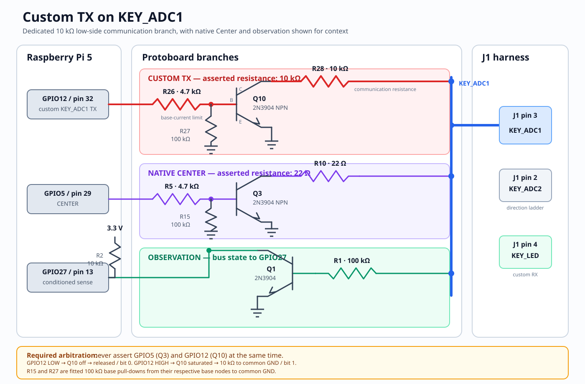

# Phase 25 Execution Record

## Purpose

Track **Phase 25: Bidirectional Custom Monitor Communication and Control UI** per the [Implementation Plan](./plan.md).

## Status

**Complete. Closed 2026-11-06.** The bidirectional custom communication path is deployed and confirmed on live monitor/deck hardware. The deck can send commands and requests, correlate typed responses, and receive unsolicited monitor messages. Raw capture, replay, diagnostics, status-driven controls, error recovery, and the expanded home-screen monitor controls are also complete.

The delivered work is materially larger than the original receiver-first story. Characterization progressed into a stable two-wire application protocol: monitor-to-deck traffic uses conditioned `KEY_LED`, while deck-to-monitor commands use the dedicated `KEY_ADC1`/`GPIO12` branch. The original communication-monitor UI was retained and expanded into an operational monitor-control surface.

## Delivered outcome

Phase 25 delivered all of the following:

- bounded callback-time `KEY_LED` edge capture with monotonic timestamps, timing statistics, glitch/rejection/overrun accounting, export, deterministic replay, and batched WebSocket delivery
- resilient frame acquisition with preamble/sync validation, CRC-8 validation, sequence-gap reporting, recovery from the known distorted leading bit, and explicit bad-CRC/incomplete-frame evidence
- typed decoding for `STATE`, `LEVEL`, `HOLD`, `RATE`, `DIAG`, `ACK`, `PRESENCE`, `WATCH`, `SCAN`, and `REFRESH`, while retaining unknown valid types for investigation
- a table-defined `KEY_ADC1` transmitter with GPIO arbitration and guaranteed release, plus request/response correlation and bounded response timeouts
- live commands for query, all single-source selections, all ordered two-source PBP layouts, diagnostics, TB refresh, and WATCH control
- unsolicited monitor messages delivered to the deck without a preceding request
- event-driven STATE recovery: startup/resume, corrupt or ambiguous STATE, missing sequence evidence, and an unanswered layout transition cause a coalesced query; there is no periodic status poll that would blink the monitor LED
- the full communication-monitor workspace with RX/TX waveform and histories, capture controls, session evidence, notes, replay/export, command controls, decoded meanings, and diagnostic results
- an expanded home-screen monitor controller: independent LED, refresh, OSD, and recording controls; fixed `3 × 2` quick source/layout controls; selected-layout indication; disconnected-source dimming without disabling commands; and a bottom-aligned JOG control with padding
- responsive page behavior outside the intentionally fixed monitor-control composition, with the application version moved beside the clock
- live deployment and hardware confirmation of commands, requests, correlated responses, and pushed/unsolicited messages

## Original checklist disposition

- [x] Confirmed `KEY_LED` remains a conditioned receive-only observation point.
- [x] Recorded clock/capture settings and physical levels with capture evidence.
- [x] Added an independent callback-time raw-edge path.
- [x] Added bounded buffering and explicit rejection/overrun counters.
- [x] Added versioned export and deterministic replay.
- [x] Added capture lifecycle/status APIs and bounded WebSocket batching.
- [x] Added interval statistics and configurable acquisition/decoder inputs.
- [x] Implemented and hardware-tested the monitor-to-deck decoder.
- [x] Replaced Calendar and Notes with the large communication monitor.
- [x] Preserved ordinary semantic LED behavior and the small deck LED indicator.
- [x] Added backend/frontend protocol, replay, corruption, response-correlation, and UI regression tests.
- [x] Characterized the live link and selected validated operating timings.
- [x] Added the unplanned but completed deck-to-monitor command path.
- [x] Expanded the deck screen into a state-aware monitor controller.
- [x] Captured and reviewed the required host-health snapshot.

## Validated protocol surface

### Monitor to deck (`KEY_LED`)

- fixed nine-byte frame with `FF FF 2D D4` preamble/sync, message type, sequence, two data bytes, and CRC
- CRC-8 polynomial `0x07`, initial value `0`, MSB-first
- default half-bit acquisition at `10 ms` with bounded timing tolerance and recovery for the observed asymmetric/leading-bit distortion
- defined message identifiers: `0x11` STATE, `0x12` LEVEL, `0x13` HOLD, `0x14` RATE, `0x15` DIAG, `0x16` ACK, `0x18` PRESENCE, `0x19` WATCH, `0x1A` SCAN, and `0x1B` REFRESH
- STATE carries layout, ordered inputs, and the physical connection mask (`HDMI=0x1`, `DP=0x2`, `TB=0x4`)

### Deck to monitor (`KEY_ADC1`)

- fixed 16-bit `A5 xx` command frames, transmitted MSB-first with a default `25 ms` bit time
- frozen codeword table for query, three single-source modes, six ordered PBP modes, diagnostic, TB refresh, and WATCH toggle
- response correlation supports STATE; the diagnostic sequence of DIAG + PRESENCE + SCAN; and REFRESH
- codes `0xC`, `0xD`, and `0xF` remain available for future short commands; more complex behaviors can use a small command sequence without changing the physical transport

| Code | Wire frame | Delivered operation |
| --- | --- | --- |
| `0x0` | `A5 5A` | Query current STATE |
| `0x1` | `A5 44` | Single HDMI |
| `0x2` | `A5 77` | Single DP |
| `0x3` | `A5 69` | Single TB |
| `0x4` | `A5 11` | PBP HDMI \| DP |
| `0x5` | `A5 0F` | PBP HDMI \| TB |
| `0x6` | `A5 3C` | PBP DP \| HDMI |
| `0x7` | `A5 22` | PBP DP \| TB |
| `0x8` | `A5 DD` | PBP TB \| HDMI |
| `0x9` | `A5 C3` | PBP TB \| DP |
| `0xA` | `A5 F0` | Diagnostic request |
| `0xB` | `A5 EE` | TB refresh |
| `0xE` | `A5 BB` | WATCH on/off |

## Custom TX on `KEY_ADC1`

### Communication signal split

| Direction | Physical monitor signal | Pi GPIO | Electrical role |
| --- | --- | --- | --- |
| Monitor → client | `KEY_LED`, J1 pin `4` | `GPIO22`, physical pin `15` | conditioned input; raw edge capture and decoded receive data |
| Client → monitor | `KEY_ADC1`, J1 pin `3` | `GPIO12`, physical pin `32` | output through `R26`, `Q10`, and `R28` |

`KEY_ADC2`, J1 pin `2`, is the separate Up/Down/Left/Right resistor ladder. It is
observed by the ADS1115 and driven by the four directional branches, but it does not
carry the Phase 25 custom communication protocol.

The Pi-side transmitter function on `GPIO12` drives the physical `KEY_ADC1` signal. It
is not a separate harness bus.

Phase 25's monitor-command transmitter uses a dedicated low-side branch on
the existing `KEY_ADC1` Center bus. It does not drive a voltage onto the bus.
Instead, `GPIO12` switches a tested `10 kOhm` resistance between the bus and ground.



The `Q10` branch is the custom `KEY_ADC1` transmitter; the other two branches are
shown because they share the same electrical bus:

| Ref | Part / value | Connection and purpose |
| --- | --- | --- |
| `Q10` | `2N3904` NPN | Custom TX low-side switch: emitter to `GND`, collector to `R28`, base driven through `R26` |
| `R26` | `4.7 kOhm` | Limits `GPIO12` current into the `Q10` base |
| `R27` | `100 kOhm` | Pulls the `Q10` base to `GND`; keeps the custom transmitter off during boot/reset |
| `R28` | `10 kOhm` | Connects `KEY_ADC1` to the `Q10` collector; selects the custom communication resistance |
| `Q3` | `2N3904` NPN | Separate native-Center low-side switch controlled by `GPIO5` |
| `R5` / `R15` / `R10` | `4.7 kOhm` / `100 kOhm` / `22 Ohm` | `Q3` base-current limit, default-off base pull-down, and native-Center bus resistance |
| `Q1` | `2N3904` NPN | High-impedance observation branch; inverts the bus state into `GPIO27` |
| `R1` / `R2` | `100 kOhm` / `10 kOhm` | Bus-to-base isolation and the `GPIO27` 3.3 V collector pull-up |

`R27` and `R15` are separate `100 kOhm` base-to-ground pull-downs. They are not in
series between the GPIO and base: `R26` and `R5` remain the `4.7 kOhm` series base
resistors, while the `100 kOhm` parts branch from each transistor base to `GND`.

### Electrical states and arbitration

| `GPIO12` | `Q10` | `KEY_ADC1` effect | Protocol meaning |
| --- | --- | --- | --- |
| `LOW` | Off | No `R28` path to ground | released / NRZ bit `0` |
| `HIGH` | Saturated | `KEY_ADC1 -> R28 (10 kOhm) -> Q10 -> GND` | asserted / NRZ bit `1` |

`GPIO5` and `GPIO12` are independent outputs but share `KEY_ADC1`. Software must
never turn on `Q3` and `Q10` together: `Q3` is the native `22 Ohm` Center action and
`Q10` is the custom `10 kOhm` communication state. The transmitter releases `Q10`
before and after every frame, including the error path. `R15` and `R27` hold their
transistor bases low while the GPIOs are high-impedance during boot/reset. All Pi,
transistor, and monitor harness grounds must be common.
Verify the actual `2N3904` package's `C/B/E` pinout
against its manufacturer datasheet before wiring; lead order is package-dependent.

The authoritative component references remain in
[the protoboard schematic](../hardware/protoboard-schematic.md), with the Pi header
assignment in [the Pi 5 GPIO schema](../hardware/pi5-gpio-schema.md). This Phase 25
addition was introduced during characterization and is now the validated production
command path with the encoding, default bit timing, and framing recorded above.

## Evidence log

- 2026-10-31: Added callback-time physical GPIO level capture using `time.monotonic_ns()`, independent of the coalesced semantic observation path.
- 2026-10-31: Added bounded raw-edge and WebSocket queues, glitch and overrun counters, timing statistics, JSON export/replay, and start/stop/clear/status APIs.
- 2026-10-31: Added the polarity-independent 1007.8-compatible decoder for `FFFF 2DD4`, version/type `0x11`, sequence, layout/inputs, and CRC-8 polynomial `0x07`.
- 2026-10-31: Golden PBP and PIP frames decode successfully after leading garbage and under polarity inversion. Corrupt CRC and truncated-frame tests reject the input.
- 2026-10-31: Replaced Calendar and Notes on the home screen with the raw waveform, capture health, timing statistics, valid/missing frame counts, decoded state, export, and replay controls. The small semantic LED remains beside the JOG pad.
- 2026-10-31: Focused backend validation: 27 tests passed. Focused frontend validation: 4 tests passed. Production frontend build passed.
- 2026-10-31: Full backend collection remains blocked by the pre-existing `test_deploy_version.py` import of missing `_build_version`/`_read_deploy_counter`; full frontend run retains pre-existing SettingsPage mock failures. Neither failure is in the Phase 25 paths.
- 2026-10-31: Live deployment/1007.7 capture could not run because the previously documented deck addresses were stale. Deployment now reads the current address from `PI_DECK_IP`.
- 2026-10-31: Deployed `0.1.12+r92` to the live `pi-deck5` host. The API and updated oscilloscope client are active.
- 2026-10-31: Added a bounded 4,096-edge browser history, fixed 0–1 level scale, 100 ms–60 s time zoom, pause/resume, clear, older/newer panning while paused, and return-to-live controls.
- 2026-10-31: Live GPIO capture is interrupt-driven and reports zero overruns. A 986-interval sample had a 21.1 ms minimum and roughly 790 ms median; it contained no interval below 15 ms, and replay across candidate 5–50 ms half-bit periods decoded no frame. A fresh post-deployment sample likewise had a 36.8 ms minimum. The client is therefore receiving transitions, but the conditioned GPIO input does not yet contain the specified dense 10/20 ms waveform.
- 2026-11-02: Updated the decoder for 1007.9 shared-sequence STATE (`0x11`) and LEVEL (`0x12`) frames, including CRC-valid unknown-type retention. The UI now updates immediately from validated frame events while displaying latest message and latest known STATE separately.
- 2026-11-02: Added 30 ms semantic LED classification: protocol bursts remain raw oscilloscope traffic, stable levels produce ordinary LED on/off events, valid messages produce one decoded log entry, and invalid bursts produce one summary.
- 2026-11-03: Documented the dedicated `GPIO12` / `Q10` custom TX path on `KEY_ADC1`, its shared-bus relationship to native Center and observation, and the required drive arbitration.
- 2026-11-03: Added a fixed three-second custom `KEY_ADC1` TX HIGH diagnostic to the communication widget and API for direct multimeter measurement; backend arbitration and `finally` release prevent overlap or a stuck asserted output.
- 2026-11-03: Standardized the current hardware documentation and protoboard KiCad labels on canonical `KEY_ADC1`, `KEY_ADC2`, and `KEY_LED` harness names; documented the `KEY_LED` RX / `KEY_ADC1` TX split and removed the competing monitor-prefix alias.
- 2026-11-03: Corrected the documentation audit after reconciling it with commit `d724f81`: restored `R15` and `R27` as fitted `100 kOhm` base-to-ground pull-downs for `Q3` and `Q10`.
- 2026-11-05: Hardware captures from firmware 1008.5 confirmed STATE layout/input/connection-mask vectors, DIAG + PRESENCE + SCAN diagnostic responses, WATCH messages, sequence handling, and the complete single/PBP command mapping.
- 2026-11-05: Added request/response session tracking, RX/TX histories, live TX samples, bad-CRC and incomplete-frame evidence, decoded diagnostic meanings, response timeouts, and correlation of responses that begin before command transmission fully returns.
- 2026-11-06: Added firmware 1008.7 TB refresh support (`A5 EE` / REFRESH `0x1B`) and exposed it as the symbol-only refresh control between the LED and OSD controls.
- 2026-11-06: Expanded the home screen with a fixed `3 × 2` quick-control composition for `TB|DP`, `TB|HDMI`, `HDMI|DP`, `TB`, `HDMI`, and `DP`. The surrounding screen remains responsive; the version is beside the clock and the JOG control is bottom-aligned with padding.
- 2026-11-06: Made quick controls monitor-state aware. The active ordered layout is selected, every button involving a disconnected source is dimmed but remains clickable, and uncertain/invalid STATE is never presented as current truth.
- 2026-11-06: Added event-driven state recovery. Initial startup/resume and evidence of corrupt, ambiguous, missing, or unanswered status schedule a coalesced QUERY. A missing response does not start periodic polling.
- 2026-11-06: Focused validation passed: 45 backend Phase 25 tests, 9 frontend communication/application tests, and the production frontend build. Commands, requests, correlated responses, and unsolicited monitor messages were then confirmed working on live hardware.
- 2026-11-06: Deployed `0.1.15+r117`; `/health` reported OK in live-hardware mode and the kiosk was reloaded successfully.

## Host health snapshot

Captured on the deployed `pi-deck5` host after Phase 25 deployment. Because the collector was streamed to `python3 -` rather than run from a repository checkout, its optional in-process `pi_deck` import check reports false; the independent localhost health check confirms deployed version `0.1.15+r117`.

```text
pi-deck host health  |  2026-11-06T17:33:32.220179+00:00
hostname: pi-deck5

[python]
  executable: /usr/bin/python3
  version:    3.13.5
  platform:   Linux-6.12.75+rpt-rpi-2712-aarch64-with-glibc2.41
  pi_deck:    importable=False  package_version=None

[cpu]
  model: Raspberry Pi 5 Model B Rev 1.1
  logical cpus: 4
  load average (1 / 5 / 15 min): 0.10  0.06  0.07

[memory]
  RAM:  total 7.87 GiB  available 6.91 GiB  (MemTotal/MemAvailable KiB: 8256448 / 7248272)
  swap: total 2.00 GiB  free 2.00 GiB  (KiB: 2097136 / 2097136)

[disk]  mount /
  size 57.97 GiB  used 5.84 GiB  avail 49.72 GiB  (10.08% used)

[thermal]  sysfs zones
  thermal_zone0  cpu-thermal  48.0 °C

[raspberry_pi]  vcgencmd (SoC voltage / throttling)
  temperature: temp=48.3'C
  voltage core: volt=0.7948V
  voltage sdram_c: volt=0.6000V
  voltage sdram_i: volt=0.6000V
  voltage sdram_p: volt=1.1000V
  get_throttled: throttled=0x0
  flags set: (none)

[systemd]
  pi-deck.service: active
  lightdm.service: active

[pi-deck HTTP]
  GET http://127.0.0.1:8756/health
  ok: True  body: '{"status":"ok","version":"0.1.15+r117"}'
```

Review: the host showed no current or historical throttle flags, low CPU load, ample RAM and swap headroom, 10.08% root-filesystem use, normal idle temperature, active deck/display services, and a healthy application endpoint.
